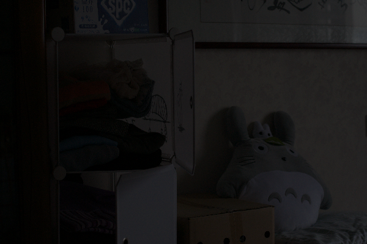
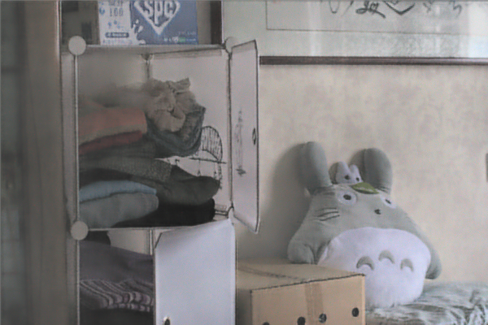
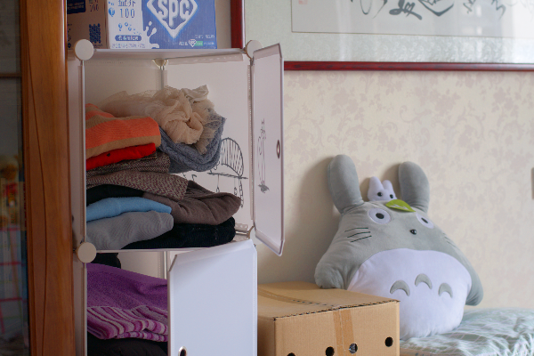

# LumenNet: Deep Learning Low-Light Image Enhancement

[](LICENSE)
[](https://www.python.org/downloads/)
[](https://www.docker.com/)
[](https://fastapi.tiangolo.com)
[](https://onnxruntime.ai/)

LumenNet is an image enhancement pipeline designed to recover structural details and accurate colors from underexposed, low-light photographs. It utilizes a deep learning approach to simulate high-ISO noise reduction and dynamic range expansion typical of modern computational photography.

## Visual Results

Below is an example of the model's performance on the validation set.

| Low Light Input                                           | Model Prediction                                                | Ground Truth                                         |
|-----------------------------------------------------------|-----------------------------------------------------------------|------------------------------------------------------|
|  |  |  |

*Sample images are sourced from the LOL-Dataset[^1], originally introduced in the paper "Deep Retinex Decomposition for Low-Light Enhancement"[^2].*

## The Problem Statement

Photography in low-light conditions presents two fundamental challenges:

1. **Signal-to-Noise Ratio (SNR) collapse:** Sensor noise overwhelms the actual image data.
2. **Color Space Distortion:** In extreme low light, RGB channels compress and desaturate, making it mathematically difficult to enhance brightness without causing chromatic shifts or severe desaturation.

## System Architecture

LumenNet provides a decoupled microservice architecture:

- **Backend:** A FastAPI-based REST API that executes an ONNX-optimized model.
- **Frontend:** A Gradio-based web interface that provides an interactive slider to compare raw inputs with the AI-enhanced outputs.

## Model Architecture

The core of LumenNet is a **U-Net architecture featuring a MobileNetV2 backbone**.

- **Encoder:** Transfer Learning is employed utilizing a pre-trained MobileNetV2 as an encoder to extract robust hierarchical spatial features.
- **Decoder:** A U-Net decoder is used to reconstruct the image from the encoded features.
- **Color Processing (The LAB Strategy):** To circumvent the desaturation and color-bleeding phenomena common in standard U-Nets, LumenNet operates conceptually within the **LAB color space**.
  - The model primarily focuses on the **L (Lightness)** channel to predict illumination adjustments.
  - The **A and B (Color)** channels are preserved and proportionally scaled based on the predicted luminance changes, mathematically guaranteeing the maintenance of the original chromaticity.
- **Inference Efficiency:** The network is exported to ONNX format, facilitating efficient execution on CPU-only infrastructure without necessitating expensive GPU resources.

## Training Methodology

- **Dataset:** The model was trained on the **LOL-Dataset (LOw-Light dataset)**[^1], consisting of 485 paired low-light and normal-light image samples (from the paper *"Deep Retinex Decomposition for Low-Light Enhancement"*[^2]).
- **Objective Function:** Optimization relies on a hybrid loss function combining:
  - **L1 Loss:** For pixel-wise intensity accuracy.
  - **SSIM (Structural Similarity) Loss:** To ensure structural edges and textures are rigorously maintained.
- **Optimization Strategy:** Trained via transfer learning with weight decay to mitigate overfitting on the small dataset, utilizing a Cosine Annealing learning rate scheduler to ensure stable convergence.

## Deployment Instructions

LumenNet is containerized using Docker. To launch the full stack, ensure [Docker](https://docs.docker.com/engine/install/) and [Docker Compose](https://docs.docker.com/compose/install/) are installed, then execute the following command from the project root:

```bash
docker compose up -d --build
```

Upon successful build and initialization, the interfaces are accessible at:

- **Graphical User Interface (GUI):** `http://localhost:7860`
- **API Documentation (Swagger UI):** `http://localhost:8000/docs`

## License

This project is licensed under the MIT License - see the [LICENSE](LICENSE) file for details.

[^1]: RAKSHIT, Soumik. *LOw-Light Dataset*. Online. 2022. [Accessed 13 May 2026]. Available from: <https://www.kaggle.com/datasets/soumikrakshit/lol-dataset>.
[^2]: WEI, Chen, WANG, Wenjing, YANG, Wenhan and LIU, Jiaying. *Deep Retinex Decomposition for Low-Light Enhancement*. Online. 1. 2018. arXiv. [Accessed 13 May 2026]. DOI: <https://doi.org/10.48550/arXiv.1808.04560>.
